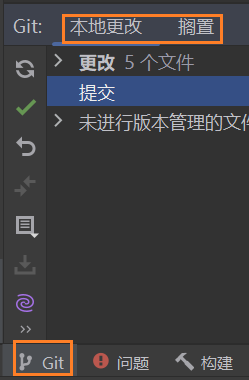
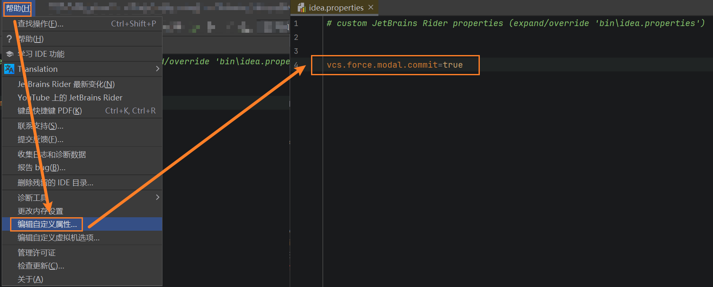

# Rider如何将提交嵌入Git窗口中

> 目标: 取消独立的 Commit 工具窗口, 将 `Local Changes` 恢复到下方 Git 工具窗口中.
>
> 适用范围: 提供 `Enable Commit tool window` 选项的 JetBrains Rider 版本. 其他 JetBrains IDE 通常也可以参考.

## W - 直接使用

### 推荐方案: 通过设置恢复 Local Changes

1. 打开 `Settings` (`Ctrl+Alt+S`).
2. 进入 `Advanced Settings > Version Control`.
3. **取消勾选 `Enable Commit tool window`.**
4. 点击 `Apply` 或 `OK`.
5. 打开下方 `Git` 工具窗口 (`Alt+9`, 以当前 Keymap 为准), 查看 `Local Changes` 页签.

**结果:** 原本单独显示的 Commit 工具窗口恢复为 Git 工具窗口内的 `Local Changes` 区域, 不需要修改自定义属性, 通常也不需要重启 IDE.

旧版所期望的布局示意如下:



> 如果你还想把 **Git Log** 从编辑器中央区域移到底部, 这与 Commit 设置是两个独立问题. 在提供该选项的 IntelliJ 平台 IDE 中, 可进入 `Settings > Version Control > Log`, 取消 `Show the log in the editor window`. 这项设置并非恢复 `Local Changes` 的必要条件.

## I - 原理与区别

部分新版 Rider 默认将本地修改列表与提交操作放在独立的 `Commit` 工具窗口中, 而传统布局将它们放在下方 `Git` 工具窗口的 `Local Changes` 页签中.

| 设置或方案                                | 实际作用                                                     | 本文建议         |
| ----------------------------------------- | ------------------------------------------------------------ | ---------------- |
| `Enable Commit tool window = Off`         | 将 Commit / Local Changes 区域并回 Git 工具窗口              | **首选**         |
| `Show the log in the editor window = Off` | 将 Git Log 从中央编辑区移回 Git 工具窗口, 仅在该选项存在时使用 | 按需             |
| `vcs.force.modal.commit=true`             | 历史版本使用过的强制模态提交方案                             | 仅保留作兼容记录 |

**关键区别:** `Local Changes` 的位置与 **Modal Commit Interface (模态提交对话框)** 是否启用, 并不是同一个设置. 当前目标只是恢复 Git 工具窗口布局, 不需要启用模态提交界面.

## S - 旧方案与特殊情况

### 历史方案: 修改自定义属性

这篇文章最初在 2026-02-07 记录的方法是:

1. 进入 `Help > Edit Custom Properties` (帮助 > 编辑自定义属性).

2. 添加:

   ```properties
   vcs.force.modal.commit=true
   ```

3. 保存并重启 Rider.

当时该方法在实际使用中起过作用, 因此保留作为历史记录:



但这个属性与 **强制使用模态提交界面** 有关, 不是专门控制 `Local Changes` 页签位置的公开设置. 不同 Rider 版本对它的支持和实际效果可能不同, 因此 **不推荐作为当前首选方案**.

如果已添加该属性, 而现在打算使用推荐方案, 可以先删除这一行, 重启 Rider, 然后使用 `Enable Commit tool window` 控制布局. 避免两套设置相互影响.

### 如果找不到该选项

- 确认搜索的是 `Advanced Settings` 中的 `Enable Commit tool window`, 而不是 `Version Control > Git` 页面.
- Rider 不同版本的选项位置和可用性可能变化, 可直接在设置搜索框中搜索 `Commit tool window`.
- 如果目标是单独弹出的旧式 **Commit Dialog**, 而不是底部 `Local Changes`, 应查看对应版本的 **Modal Commit Interface** 设置或插件, 不要混为一谈.

## E - 参考资料

- [JetBrains Rider 官方文档 - Commit and push changes (Customize the commit tool window)](https://www.jetbrains.com/help/rider/Commit_and_push_changes.html#customize-commit-tool-window)
- [JetBrains Rider 官方文档 - Advanced Settings](https://www.jetbrains.com/help/rider/Advanced_settings.html)
- [JetBrains YouTrack - IJPL-177161 (关于 Modal Commit 界面变更的讨论)](https://youtrack.jetbrains.com/issue/IJPL-177161)
