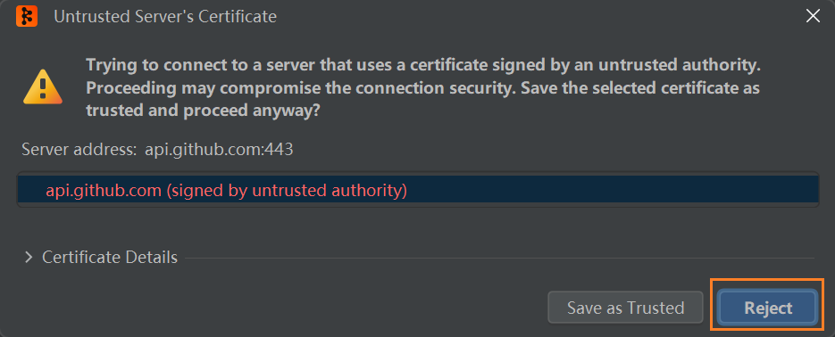
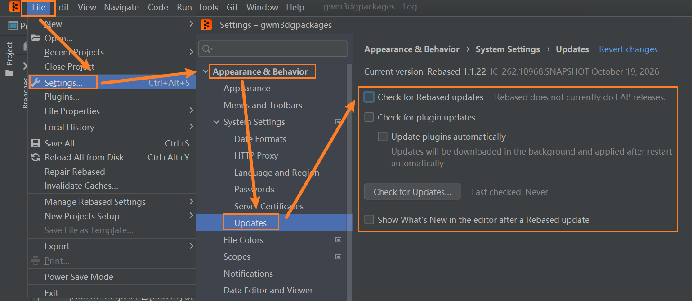

# [Git]Rebased Windows 11 免安装部署与传统 Git 界面恢复

> 适用环境: Windows 11 x64, Rebased 1.1.22. 目标是使用 Rebased 的 Git 功能, 同时恢复传统 IntelliJ IDEA 的底部 Git 工具窗口布局.

## W - 直接使用

### 1. 下载并启动免安装版

1. 打开 [Rebased 1.1.22 Release](https://github.com/DetachHead/rebased/releases/tag/1.1.22).
2. 普通 Intel / AMD Windows 11 选择 `rebased.win.zip` (Windows x64 Portable), 不下载 Source code.
3. 解压整个 ZIP 到固定目录, 例如 `D:\Program Files\rebased.win\`.
4. 启动 `D:\Program Files\rebased.win\bin\rebased64.exe`, 可为该文件创建快捷方式.
5. 首次启动如果弹出如下窗口, 请先点击Reject进行拒绝.
   

不要单独移动 `rebased64.exe`, 需要保留解压后的目录结构.

### 2. 安装两个插件

打开 `Settings (Ctrl+Alt+S) > Plugins > Marketplace`, 分别搜索并安装:

| 插件 | 作用 |
| --- | --- |
| `Classic UI` | 恢复 JetBrains 传统界面风格及工具窗口布局. |
| `VSCode Keymap` | 提供 VS Code 风格的快捷键映射. |

安装后按照提示重启 Rebased. 在 `Settings > Plugins > Installed` 中检查两个插件均已启用.

若希望真正使用 VS Code 快捷键, 还需要进入 `Settings > Keymap`, 选择 `VSCode`. 仅安装插件不代表已经切换 Keymap.

### 3. 把 Local Changes 恢复到下方 Git 页签

进入 `Settings > Advanced Settings > Version Control`, **取消勾选**:

```text
Enable Commit tool window
```

应用后, 提交/本地修改列表不再独立占据 Commit 工具窗口, 而是回到 Git 工具窗口中的 Local Changes 区域.

### 4. 把 Git Log 移到下方 Git 页签

进入 `Settings > Version Control > Log`, **取消勾选**:

```text
Show the log in the editor window
```

应用后, Git Log 不再占用中央编辑区, 而是显示在下方 Git 工具窗口.

### 5. 处理Rebased 每次启动弹出 GitHub 证书警告

- 打开 `Settings > Appearance & Behavior > System Settings > Updates`.
- 关闭自动检查更新 (`Check for Rebased updates`).
- 其他更新看情况处理.(其他更新的选项不会导致证书警告)



### 6. 最终检查

- `Classic UI` 与 `VSCode Keymap` 均处于 Enabled 状态.
- 下方 Git 工具窗口能查看 `Local Changes` 与 `Log`.
- 中央编辑区不再被 Git Log 默认占用.
- Git `Fetch`, `Diff`, `Commit` 等基本操作正常.
- 重启 Rebased, 确认不再弹出证书警告.

## I - 设置说明

Rebased 基于 IntelliJ 平台构建, 核心用途是提供独立的 Git 图形化客户端. 因此它的默认窗口组织方式与传统 IDEA 不完全一致.

这次恢复界面由三类设置共同完成:

| 配置 | 负责的内容 |
| --- | --- |
| `Classic UI` | 界面视觉风格及工具窗口外观. |
| `Enable Commit tool window = Off` | 把提交/本地修改区域放回 Git 工具窗口. |
| `Show the log in the editor window = Off` | 把 Git 历史记录从中央区域移回底部. |
| `VSCode Keymap` + 选择 `VSCode` | 让快捷键接近 VS Code 习惯, 不负责布局. |

**注意:** 仅安装 `Classic UI` 不会自动替你修改 Commit 与 Log 的两个独立设置.

## S - 特殊情况与可选优化

### GitLab 修改密码后 Fetch 认证失败

如果 GitLab 修改密码后, Rebased 执行 `Fetch` 时出现 `HTTP Basic: Access denied`, 优先确认 `Settings > Version Control > Git > Use credential helper` 已勾选, 让 Rebased 使用 Git 配置的 Credential Helper.

**更新 Windows 中保存的 GitLab 凭据:**

1. 按 `Win + R`, 输入以下命令并回车:

   ```text
   control /name Microsoft.CredentialManager
   ```

2. 打开 `Windows 凭据 > 普通凭据` (Generic Credentials).
3. 查找包含 `gitlab.gwm.cn` 的条目, 例如 `git:http://gitlab.gwm.cn`.
4. 选择 `编辑`, 将旧凭据更新为当前密码或 Token. 如果无法编辑, 只删除这一条对应 GitLab 的凭据.
5. 返回 Rebased, 重新执行 `Fetch`. 如果弹出认证窗口, 输入 GitLab 用户名及新的密码或 Personal Access Token (PAT).

不要清空其他 Windows 凭据. 如果新密码仍然被拒绝, 需确认公司 GitLab 是否要求使用 PAT, 以及 Token 是否有效并具有对应的仓库访问权限.

**安全提示:** 当前仓库如果使用 `http://` 远程地址, 认证信息可能经未加密连接传输. 如公司 GitLab 支持, 建议优先使用 HTTPS 或 SSH.

### 不让 Rebased 在仓库根目录生成 `.idea`

进入 `Settings > Appearance & Behavior > System Settings`, 取消勾选:

```text
Store project settings in the project root directory
```

这样会把项目配置集中保存到 Rebased 的配置位置, 而不是写入当前仓库根目录. 已经存在的 `.idea` 目录不会因此自动删除.

### 不需要文件搜索时, 可关闭索引

同一设置页面中, 可根据需要取消 `Enable indexing files for search`. 这不会消除所有 Git 文件扫描, 仅减少搜索功能相关的索引工作. 此项不是恢复 UI 所必需的.

### 首次启动提示 GitHub API 证书不受信任

如果 `api.github.com` 的证书明显异常且不能确认来源, 应选择 `Reject`, 不要使用 `Save as Trusted` 绕过验证. 这可能影响 GitHub API 集成功能, 不必然妨碍本地 Git 操作.

## E - 参考资料

- [Rebased 官方仓库及 README](https://github.com/DetachHead/rebased)
- [Rebased 1.1.22 Release](https://github.com/DetachHead/rebased/releases/tag/1.1.22)
- [JetBrains - Classic UI 插件](https://plugins.jetbrains.com/plugin/24468-classic-ui)
- [JetBrains - VSCode Keymap 插件](https://plugins.jetbrains.com/plugin/12062-vscode-keymap)
- [JetBrains - 插件安装说明](https://www.jetbrains.com/help/idea/managing-plugins.html)
- [JetBrains - Commit 窗口布局说明](https://www.jetbrains.com/help/idea/commit-and-push-changes.html)
- [JetBrains - VSCode Keymap 设置说明](https://www.jetbrains.com/help/idea/how-to-move-to-intellij-idea-from-vs-code.html)
